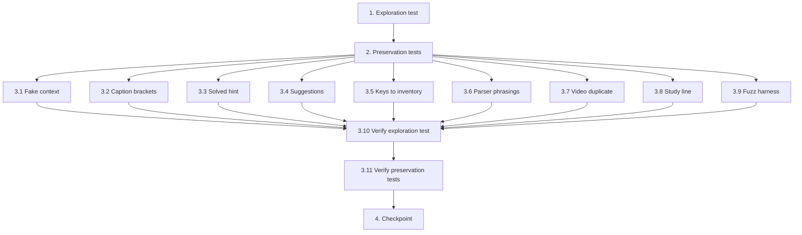

# Implementation Plan

## Overview

Fix nine playtest findings in order: exploration test, preservation tests, nine independent fixes, then verification. Run tests with `npx vitest --run` (the soft-lock suite alone takes about three minutes). Do not start a watcher. Do not change game code before task 1 and task 2 are done. Write the exploration tests BEFORE implementing the fix, and run them on UNFIXED code to understand each defect.

## Task Dependency Graph



```json
{
  "waves": [
    { "id": 0, "tasks": ["1"] },
    { "id": 1, "tasks": ["2"] },
    { "id": 2, "tasks": ["3.1", "3.2", "3.3", "3.4", "3.5", "3.6", "3.7", "3.8", "3.9"] },
    { "id": 3, "tasks": ["3.10"] },
    { "id": 4, "tasks": ["3.11"] },
    { "id": 5, "tasks": ["4"] }
  ]
}
```

Tasks 3.1 to 3.9 do not depend on each other. Run them one at a time and re-run the walkthrough after each.

## Tasks

- [x] 1. Write bug condition exploration test
  - **Property 1: Bug Condition** - Playtest findings (C1 to C9)
  - **CRITICAL**: This test MUST FAIL on unfixed code. Failure confirms the defects exist.
  - **DO NOT attempt to fix the test or the code when it fails**
  - **NOTE**: This test encodes the expected behavior. It validates the fix when it passes after implementation.
  - **GOAL**: Surface counterexamples for each defect in the isBugCondition pseudocode in the design
  - **Scoped PBT Approach**: Defects C1, C2, C7 and C8 are deterministic, so scope each property to its concrete failing case. Use fast-check for C3, C5, C6 and C9, where inputs vary.
  - Create `tests/playtest-findings.test.ts` with one `describe` block per defect:
    - C1 and C2: the two existing failing tests in `src/audio/voice.test.ts` serve as the exploration tests. Add one new check that no UI line from a full walkthrough starts with `[[`.
    - C3: for each of the five puzzles, play to its solved flag, send HINT, and expect the message `hint:<puzzle>:solved`, no `hint:<puzzle>:1..3`, and an unchanged `hintTier`.
    - C4: carry the pencil and Walkman into the hallway, send `examine unicorn`, and expect the suggestion to name only hallway items first.
    - C5: after each of the five key-revealing commands, expect the key in the inventory and the matching exit to open without TAKE.
    - C6: parse every phrase in the NaturalPhrasings table in the design and compare with its canonical command; `i need a hint` must be an unknown verb.
    - C7 and C8: play the walkthrough and assert that no sentence of four or more words repeats within one turn, and that `study:forward` is at most three sentences and does not restate its caption.
    - C9: run the 300-command fuzz loop in-process with seeds 1986, 7 and 42, first from a fixed state and then threaded, and assert no response reaches 30 repeats.
  - Run the test on UNFIXED code
  - **EXPECTED OUTCOME**: Test FAILS (this is correct and proves the defects exist). C8 may pass, which means the assumed complaint about the Study line was wrong; report that and ask the owner what the complaint was.
  - Document the counterexamples found (for example `[0, 0, 0, 0]`, `[[Dad's voice, over the static]]`, 73 repeats with seed 1986)
  - Mark the task complete when the test is written, run, and the failures are documented
  - _Requirements: 1.1, 1.2, 1.3, 1.4, 1.5, 1.6, 1.7, 1.8, 1.9_

- [x] 2. Write preservation property tests (BEFORE implementing the fix)
  - **Property 2: Preservation** - Behavior outside the defects is unchanged
  - **IMPORTANT**: Follow the observation-first methodology
  - Observe on UNFIXED code, then write property-based tests for these non-bug inputs:
    - The canonical walkthrough reaches the ending with warmth 4 and the pencil (run `run_walkthrough` and `tests/walkthrough.test.ts`)
    - `search cartridge box` then `search foam` finds the basement key with no tape played, and the closet and inside pocket give the hallway key with no message heard. The toybox, disk box and clock radio cover stay shut before their clues.
    - Parse snapshot: every verb synonym in `content/verbs.json` combined with a small set of noun aliases, and every walkthrough command, parses to the same command as recorded on unfixed code
    - HINT in each unsolved room gives tiers 1, 2, 3, 3 and updates `hintTier` as before
    - Noun-failure lines start with one of the four existing wordings and end with "Try EXAMINE with ..." or "Try LOOK."
    - Muted, missing-file and decode-failure audio still show captions and never throw, and only the forward record step is reversed
    - The same state and command give the same result, and the input state is not mutated
  - Property-based testing generates many command sequences for stronger guarantees
  - Run the tests on UNFIXED code
  - **EXPECTED OUTCOME**: Tests PASS (this confirms the baseline behavior to preserve)
  - Mark the task complete when the tests are written, run, and passing on unfixed code
  - _Requirements: 3.1, 3.2, 3.3, 3.4, 3.5, 3.6, 3.7, 3.8, 3.9, 3.10_

- [x] 3. Fix the playtest findings

  - [x] 3.1 Fix the fake audio context in the buffer-contents test (C1)
    - In `src/audio/voice.test.ts`, make `createBuffer` and `decodeAudioData` allocate each sample array once and return it from every `getChannelData` call
    - Do not change `src/audio/audio.ts`
    - _Bug_Condition: C1(X) from design_
    - _Expected_Behavior: reversed buffer equals [0.4, 0.3, 0.2, 0.1]_
    - _Preservation: audio code and the other voice tests unchanged_
    - _Requirements: 1.1, 2.1, 3.7_

  - [x] 3.2 Show each sound caption in one pair of brackets (C2)
    - In `src/ui/session.ts`, add a pure helper that removes one leading `[` and one trailing `]` and wraps once, and use it for SOUND lines in `linesFor`
    - Leave the engine's caption strings and `withVoiceCaptions` alone
    - Update any test that expected `[[`
    - _Bug_Condition: C2(X) from design_
    - _Expected_Behavior: one bracket pair, voice caption `[Dad's voice, over the static]` shown once_
    - _Preservation: captions still shown when muted or when files are missing_
    - _Requirements: 1.2, 2.2, 3.7_

  - [x] 3.3 Add a solved-state hint (C3)
    - Add a required `solved` string to the hints schema, the `HintDef` type and `content/hints.json` for all five puzzles, and update the loader test fixtures
    - Add the puzzle-to-solved-flag map, and make `hint` emit `hint_lead` and `hint:<puzzle>:solved` without changing `hintTier` when the flag is set
    - Make `describeMessage` resolve `hint:<puzzle>:solved`
    - Use the narrator-writer agent to polish the five solved lines from the proposals in the design (content only, no solution reveal, no mention of where the key is, never mock Dad)
    - _Bug_Condition: C3(X) from design_
    - _Expected_Behavior: solved-state hint, tier unchanged_
    - _Preservation: tiers 1 to 3 in unsolved rooms_
    - _Requirements: 1.3, 2.3, 3.5_

  - [x] 3.4 List the current room's items first in noun-failure suggestions (C4)
    - Add the optional `roomItems` option to `interpret`, order `scopedNames` room items first and carried items after, and pass `content.rooms[state.room].items` from `src/ui/session.ts` and `src/engine/index.ts`
    - Keep the four wordings and the "Try EXAMINE with ..." ending
    - _Bug_Condition: C4(X) from design_
    - _Expected_Behavior: current room's in-reach items come first_
    - _Preservation: wording and reach rules_
    - _Requirements: 1.4, 2.4, 3.6_

  - [x] 3.5 Put found keys in the inventory (C5)
    - Add the shared key-collection helper in `src/engine/puzzles/util.ts` and call it from the five `afterStep` first-discovery branches, in the order found text, taken line, `PUZZLE_SOLVED`
    - In `src/engine/world.ts` `take` and in `interpret.ts` `resolveSlot`, answer `already_held` when every candidate is already carried
    - Keep the per-room `take` handlers. Do not edit `content/walkthrough.json`.
    - Re-run the walkthrough, the soft-lock suite and the property tests
    - _Bug_Condition: C5(X) from design_
    - _Expected_Behavior: key in inventory the same turn, exit opens without TAKE_
    - _Preservation: ungated basement and hallway keys, gated toybox, disk box and cover, `take key` lines still harmless_
    - _Requirements: 1.5, 2.5, 3.1, 3.2, 3.3_

  - [x] 3.6 Parse natural phrasings (C6)
    - In `src/engine/parser/parser.ts`: move a trailing particle next to the verb when the verb phrase exists, drop a trailing particle from a noun phrase, skip articles while matching verb phrases, and accept "i" and "l" only on their own
    - In `content/verbs.json`: add the synonyms listed in the design (all unique across verbs), and give UNLOCK and OPEN a second object with "with" and "using"
    - Run the synonym-uniqueness test and the parser tests
    - Run `fuzz_commands` after this change, as the project rules require
    - _Bug_Condition: C6(X) from design_
    - _Expected_Behavior: every NaturalPhrasings row parses to its canonical command_
    - _Preservation: every existing parse unchanged, unknown verbs still in character_
    - _Requirements: 1.6, 2.6, 3.4_

  - [x] 3.7 Remove the duplicated video line (C7)
    - In `src/engine/puzzles/grandparentsBedroom.ts`, change `adjust_clear_prefix` to "One last nudge."
    - Do not touch the video text, `VIDEO_FINAL_LINE`, the silence beat, the SOUND captions or `video_adult_dad_final`
    - _Bug_Condition: C7(X) from design_
    - _Expected_Behavior: "static clears all at once" appears once_
    - _Preservation: video paragraphs, order and replay text_
    - _Requirements: 1.7, 2.7, 3.8, 3.9_

  - [x] 3.8 Rewrite the Study forward-play line (C8)
    - In `src/engine/puzzles/study.ts`, rewrite `study:forward` and `study:forward_again` to three sentences or fewer that do not restate the caption, keeping the word "cat" in `study:forward`
    - Leave the caption, the cue, the reversed-record text and `voice.ts` unchanged
    - Skip this task and report back if task 1 showed the assumed complaint was wrong
    - _Bug_Condition: C8(X) from design_
    - _Expected_Behavior: at most three sentences, no caption restatement_
    - _Preservation: reversed-record text, silence beat, voice mapping_
    - _Requirements: 1.8, 2.8, 3.8_

  - [x] 3.9 Carry state between fuzz commands (C9)
    - In `tools/playtest-mcp/server.ts`, replace the reused `base` with a `state` that takes `r.state` after each command, and restart from a fresh game when the ending is reached
    - Do not edit `engineAdapter.ts` or change what `runInput` returns
    - Tell the owner to restart the MCP server so it loads the change
    - _Bug_Condition: C9(X) from design_
    - _Expected_Behavior: no response reaches the reporting threshold for seeds 1986, 7, 42_
    - _Preservation: seeded, reproducible runs and the report format_
    - _Requirements: 1.9, 2.9, 3.10_

  - [x] 3.10 Verify bug condition exploration test now passes
    - **Property 1: Expected Behavior** - Playtest findings are fixed
    - **IMPORTANT**: Re-run the SAME tests from task 1. Do NOT write new tests.
    - The tests from task 1 encode the expected behavior
    - **EXPECTED OUTCOME**: Tests PASS (confirms the defects are fixed)
    - _Requirements: 2.1, 2.2, 2.3, 2.4, 2.5, 2.6, 2.7, 2.8, 2.9_

  - [x] 3.11 Verify preservation tests still pass
    - **Property 2: Preservation** - Behavior outside the defects is unchanged
    - **IMPORTANT**: Re-run the SAME tests from task 2. Do NOT write new tests.
    - **EXPECTED OUTCOME**: Tests PASS (confirms no regressions)
    - Confirm all tests still pass after the fix

- [x] 4. Checkpoint - Ensure all tests pass
  - Run `npx vitest --run` and confirm the full suite passes, including the two voice tests that failed before
  - Run `run_walkthrough` and confirm the ending is reached
  - Run `find_softlocks` and report whether `truncated` is true. A truncated search is not a proof.
  - Restart the MCP server, run `fuzz_commands` again (default seed, 300 commands) and record the new `repetitiveResponses`
  - Update the "Not fixed, and not verified" paragraph in `docs/writeup.md` with the real results
  - Ensure all tests pass, ask the user if questions arise.

## Notes

- Keys found before the clue scene (basement, hallway) is intended behavior and is pinned by task 2, not changed.
- Do not edit `video_adult_dad_final`, `content/voice-lines.json` or `public/audio/voice/index.json`.
- Follow the `.kiro/steering` rules for any new player-facing text: dry second person, never mock Dad, no lyrics, no profanity, nothing after the ending.
- The MCP fuzz tool only picks up the harness change after the MCP server restarts.
- Out of scope: fixed single-line responses with fewer than 8 variants (`no_exit`, `not_here`, `need_object`, the empty-input lines), pronoun parsing, "leave" and "exit".
